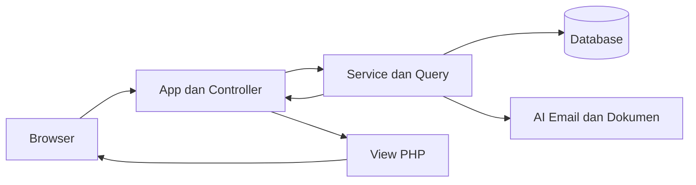
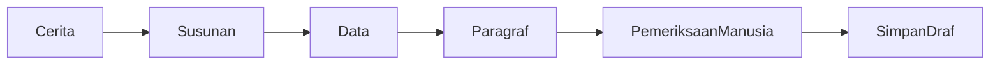

# Dokumentasi Teknis PENA

Panduan memahami kode arsitektur data dan operasional

Edisi 21 November 2026 · Untuk pemilik proyek dan pengembang

PENA adalah aplikasi PHP native untuk menyusun surat pribadi dan organisasi, memeriksa hasil AI, mengajukan persetujuan bertahap, menyimpan tanda tangan gambar per versi dan mengekspor dokumen final. Fondasinya mempertahankan template MVC wajib dosen. Aplikasi tidak diganti menjadi Laravel, React atau framework aplikasi lain.

Dokumen ini menjelaskan implementasi yang dibaca dari repositori `pena`, bukan seluruh ide dalam percakapan awal. Status deployment dan hasil tes terdahulu bersumber dari `SESSION.md`. Penyusunan dokumentasi tidak menjalankan ulang seluruh pengujian aplikasi, mengirim email atau memanggil model AI.

## 1 Cara mempelajari proyek ini

Mulailah dengan satu alur yang bisa dilihat di browser. Cari controller penerima permintaannya, ikuti service yang dipanggil, periksa tabel yang berubah, lalu lihat view hasilnya. Dengan cara ini, nama folder mempunyai konteks perilaku.

| Urutan baca | Berkas | Yang dipahami |
| --- | --- | --- |
| 1 | `README.md`, `composer.json`, `package.json` | Cara menjalankan, dependensi dan perintah proyek |
| 2 | `index.php`, `app/init.php`, `app/core/App.php` | Bootstrap dan pemilihan controller dari URL |
| 3 | `app/core/Controller.php`, `app/core/Database.php` | Session, guard akun, CSRF, respons dan koneksi |
| 4 | `app/controller/surat.php` | Koordinasi membuat, menyimpan dan mengajukan surat |
| 5 | `app/Service/LetterService.php`, `LetterQuery.php` | Aturan mutasi dan pembacaan data surat |
| 6 | `app/Service/ApprovalService.php`, `ApprovalFlow.php` | Token, keputusan, tahap dan revisi |
| 7 | `app/Service/LetterAiService.php`, `AiSettings.php`, `AiClient.php` | Validasi hasil, pemilihan credential dan panggilan model |
| 8 | `database/pena_schema.sql`, `tests/` | Struktur penyimpanan dan bukti perilaku |

Berkas di `app/Service` pada tabel memakai direktori yang sama jika hanya nama pendek yang disebut. Semua path berikut dihitung dari root aplikasi `pena`, kecuali dinyatakan lain.

### Lima konsep sebelum membaca kode

**Akun** adalah orang yang masuk. **Ruang kerja** membatasi arsip, kop, direktori pemeriksa dan surat. **Surat** adalah identitas proses yang bertahan. **Versi surat** menyimpan isi tertentu dari surat tersebut. **Permintaan persetujuan** menghubungkan pemeriksa dengan satu versi, bukan seluruh surat selamanya.

Contoh: surat nomor internal 42 memiliki versi 1 dan versi 2. Ketua menyetujui versi 1. Persetujuan itu tidak boleh digunakan untuk mengklaim ketua menyetujui isi versi 2.

## 2 Teknologi dan struktur direktori

| Bagian | Implementasi |
| --- | --- |
| Backend | PHP minimal 8.2 menurut Composer; runtime produksi terakhir tercatat PHP 8.3 |
| Fondasi | PHP native MVC dari template dosen, dengan service dan query untuk logika domain |
| Database | MySQL/MariaDB melalui mysqli, prepared statement dan mode SQL strict |
| Dependensi backend | Composer, `phpoffice/phpword`, `vlucas/phpdotenv` |
| Antarmuka | View PHP, Tailwind CSS 4, JavaScript biasa, font lokal |
| AI | HTTP Chat Completions kompatibel OpenAI; preset provider dan endpoint kustom publik |
| Email | Resend API melalui `ResendMailer` |
| Dokumen | PHPWord menghasilkan DOCX; converter Word COM atau LibreOffice menghasilkan PDF |
| Produksi | Nginx, PHP-FPM, MariaDB, tunnel HTTPS dan direktori rilis pada VPS |

```text
pena/
  index.php                   front controller
  app/
    init.php                  bootstrap, dotenv, autoload, timezone
    config/config.php         konfigurasi dasar dari environment
    core/                     App, Controller, Database, Security
    controller/               penerima permintaan HTTP
    model/User_model.php      autentikasi akun dari fondasi MVC
    Service/                  aturan domain, query dan adapter layanan
    Support/                  Db dan Migrator
    view/                     HTML halaman dan komponen PHP
  database/                   skema, migrasi, fixture demo terpisah
  public/assets/              CSS hasil build, JS, font dan favicon
  resources/css/app.css       sumber desain dan Tailwind
  scripts/                    instalasi, server lokal, pemeriksaan, operator CLI
  tests/                      unit dan integrasi dengan database sementara
  storage/                    keluaran privat sesuai konfigurasi deployment
  docs/                       laporan, keputusan dan dokumentasi ini
```

`composer.lock` mengunci dependensi backend yang dipasang. `package-lock.json` dan `npm ci` membantu mengulang build frontend. Server produksi tidak perlu Node untuk melayani CSS hasil build yang telah disimpan.

## 3 Arsitektur MVC dan bukti implementasinya



**Model** dalam MVC tidak harus seluruhnya berada di folder `app/model`. Pada PENA, `User_model` menangani pembacaan credential login, sedangkan `LetterService`, `ApprovalService`, `WorkspaceService`, `LetterQuery` dan kelas sejenis adalah bagian dari lapisan model aplikasi.

**Controller** menerima input HTTP, memeriksa konteks pengguna, CSRF dan akses, memanggil service, lalu memilih view, JSON atau redirect. **View** mengubah data yang disiapkan menjadi HTML, termasuk pemformatan dan formulir.

| Lapisan | Bukti kode yang dapat ditelusuri |
| --- | --- |
| Entry point | `index.php` memuat bootstrap dan membuat `App` |
| Router | `App` memilih berkas controller, nama metode dan parameter URL |
| Base controller | `Controller::display`, `start_default_session_app`, `verify_csrf_token`, `json_response` |
| HTTP pengajuan | `surat::ajukan` menerima ID, memeriksa konteks dan memanggil service |
| Domain surat | `LetterService::submit` memvalidasi, memberi nomor, membekukan versi dan membuka pemeriksaan |
| Data access | `Db::one`, `all`, `value`, `run`, `insert`, `transaction` |
| Pembacaan detail | `LetterQuery::detail` dan `preview` |
| Presentasi | `app/view/surat/detail.php` menampilkan data dan tindakan yang tersedia |

### Batas pemisahan yang masih ada

PENA mengikuti pola MVC dengan tambahan service/query, tetapi pemisahannya belum sepenuhnya ketat. Dashboard masih berisi query catatan revisi. Controller surat mengoordinasikan transaksi penyimpanan draf AI dan pengaitan log. View menghitung beberapa ringkasan dan melakukan format tanggal atau data tampilan.

Pemeriksaan `composer test:architecture` memeriksa pewarisan controller, keberadaan entry point dan view tanpa koneksi/query database. Catatan terakhir menyebut 12 controller native dan 28 view. Hasil ini mendukung batas yang diperiksa, bukan pembuktian bahwa seluruh desain sempurna atau bebas bug.

## 4 Alur HTTP dari URL sampai tampilan

Contoh `GET /surat/detail/42` berjalan sebagai berikut. Angka 42 di sini hanya contoh, bukan rujukan data pengguna tertentu.

1. Web server meneruskan permintaan aplikasi ke `index.php`.
2. `app/init.php` menetapkan timezone Asia/Makassar, memuat Composer, membaca environment dan memuat inti MVC.
3. `App` memilih controller `surat`, metode `detail` dan parameter `42`.
4. Controller memulai session dan menjalankan guard akun. Akun harus aktif, versi autentikasi session harus sesuai, email harus verified dan pengguna biasa harus memiliki koneksi AI pribadi.
5. `_context` menentukan ruang aktif, lalu akses surat diperiksa terhadap ruang itu.
6. `LetterQuery` mengambil surat, versi dan data tampilan, kemudian renderer menyiapkan pratinjau.
7. `Controller::display` memuat view dengan array `$data`; fungsi escape digunakan untuk teks yang dimasukkan ke HTML.

### Memahami guard yang berbeda

**Guard akun** menolak session usang dan mengarahkan akun yang belum memenuhi persyaratan. **Guard ruang** memastikan akun berhak mengakses organisasi. **Guard operator** memeriksa tabel operator yang eksplisit. **Guard tamu** memvalidasi tautan pemeriksaan beserta versi dan statusnya. Satu guard tidak menggantikan yang lain.

Endpoint AI tanpa koneksi pribadi mengembalikan JSON 403 dengan `setup_url`, sedangkan navigasi HTML diarahkan ke Pengaturan AI. Rute login/logout, verifikasi/pemulihan, Bantuan dan review tamu tetap dapat diakses sesuai guard masing-masing. Pengguna yang hanya membuka review tidak dibebani setup AI.

### Peta rute utama

| Rute | Metode utama | Fungsi |
| --- | --- | --- |
| `/`, `/login/`, `/daftar/` | GET | Halaman publik dan formulir akun |
| `/login/authenticate/`, `/daftar/simpan/` | POST | Login atau pendaftaran |
| `/login/logout/` | GET | Mengakhiri session |
| `/akun/verifikasi/`, `/akun/lupa/` | GET | Status email atau formulir pemulihan |
| `/akun/kirim/`, `/akun/pemulihan/` | POST | Mengirim permintaan email |
| `/akun/konfirmasi/`, `/akun/reset/` | GET dan POST | Membaca token fragmen ke formulir, lalu konfirmasi melalui POST |
| `/dashboard/`, `/surat/` | GET | Beranda dan daftar surat |
| `/ruang/mulai/`, `/ruang/baru/` | GET | Pilihan atau pembuatan ruang |
| `/ruang/pribadi/`, `/ruang/organisasi/`, `/ruang/pilih/{id}` | POST | Profil pribadi, membuat atau beralih ruang |
| `/surat/buat/`, `/surat/manual/`, `/surat/hasil/` | GET | Alur pembuatan dan pemeriksaan draf |
| `/surat/susun/`, `/surat/ai_kerangka/`, `/surat/ai_data/`, `/surat/ai_paragraf/` | POST | Pipeline AI, termasuk endpoint JSON |
| `/surat/tulis_ulang/`, `/surat/simpan_ai/`, `/surat/simpan/` | POST | Menulis ulang atau menyimpan draf |
| `/surat/detail/{id}`, `/surat/edit/{id}` | GET | Membaca atau mengubah draf |
| `/surat/perbarui/{id}`, `/surat/ajukan/{id}`, `/surat/revisi/{id}` | POST | Simpan perubahan, ajukan atau mulai versi baru |
| `/surat/batal/{id}`, `/surat/ganti/{id}`, `/surat/tautan/{id}` | POST | Batalkan, ganti pemeriksa atau terbitkan tautan |
| `/surat/unduh/{id}` | POST | Unduh DOCX/PDF final dengan format yang dipilih |
| `/review/lihat/{token}` | GET | Pratinjau versi untuk tamu |
| `/review/setuju/{token}`, `/review/revisi/{token}`, `/review/komentar/{token}` | POST | Keputusan atau komentar tamu |
| `/preferensi/` dan `/preferensi/simpan/`, `/hapus/`, `/uji/` | GET lalu POST | Pengaturan koneksi AI per akun |
| `/bantuan/`, `/bantuan/selesai/` | GET lalu POST | Panduan tetap dan preferensi penutupan hint |
| `/operator/`, `/operator/akun/`, `/organisasi/`, `/layanan/`, `/log/` | GET | Panel metadata operator; suffix berada di bawah `/operator/` |
| `/operator/status/{id}`, `/operator/uji_ai/` | POST | Perubahan status akun dan uji AI oleh operator |

Tabel ini adalah peta kerja, bukan kontrak API publik lengkap. Parameter form, status yang boleh berubah dan respons error tetap harus diperiksa pada controller/service terkait. Jangan menjadikan keberadaan metode router sebagai bukti bahwa metode tersebut bebas diakses.

## 5 Peta modul dan tanggung jawab

| Modul | Kelas utama | Tanggung jawab |
| --- | --- | --- |
| Akun | `AccountService`, `User_model`, `AccountEmail`, `ResendMailer` | Password, token email/reset, pencabutan session dan isi email |
| Ruang kerja | `WorkspaceService` | Registrasi dan ruang pribadi dalam transaksi, organisasi, membership, profil, kop dan pemeriksa |
| Surat | `LetterService`, `LetterQuery` | Mutasi yang sah, versi, snapshot, query detail dan daftar |
| Kerangka dan render | `TemplateValidator`, `PersonalTemplate`, `LetterRenderer` | Definisi yang boleh dipakai, jenis isian, penanda dan pratinjau |
| Nomor | `LetterNumberService` | Counter per organisasi/seri/tahun dengan row lock |
| Persetujuan | `ApprovalService`, `ApprovalFlow` | Akses token, keputusan, aktivasi tahap dan konfirmasi ulang |
| Tanda tangan | `SignatureService` | Validasi PNG, normalisasi dan bukti gambar per versi/slot |
| AI domain | `LetterAiService`, `AiDraftStore` | Pipeline, pemeriksaan hasil, log serta proses session yang berversi |
| AI koneksi | `AiSettings`, `AiEndpoint`, `AiClient` | Enkripsi, kebijakan operator, endpoint publik dan transport HTTP |
| Ekspor | `ExportService`, `WordDocumentService`, `PdfConverter` | Otorisasi unduh, cache berdasarkan versi, DOCX dan kontrak converter |
| Converter | `WordPdfConverter`, `LibreOfficePdfConverter` | Konversi sesuai sistem operasi dan ketersediaan aplikasi |
| Operator | `OperatorService` | Metadata, status akun, audit, uji layanan dan grant/revoke CLI |
| Pendukung | `RateLimiter`, `UserGuide`, `Db`, `Migrator` | Pembatasan, preferensi hint, akses SQL dan migrasi |

`PenaException` membawa kesalahan domain yang dapat ditampilkan secara aman. `AiException` membedakan kegagalan layanan AI. `AiInvalid` membawa masalah struktur/validasi hasil untuk penanganan pipeline. Jangan mengganti semua error menjadi sukses kosong; pengguna memerlukan penyebab dan langkah berikutnya yang sesuai.

## 6 Model data dan hubungan tabel

Gunakan `database/pena_schema.sql` sebagai sumber skema lengkap. Berkas SQL tambahan memuat bagian skema akun, operator, tanda tangan dan AI settings. `Migrator` membuat `schema_migrations` untuk mencatat perubahan yang telah diterapkan.

| Tabel | Isi utama dan relasi |
| --- | --- |
| `users` | Identitas akun, hash password, status, email_verified_at, auth_version, marker hint |
| `organizations` | Ruang pribadi/organisasi, pemilik dan profil JSON |
| `organization_members` | Hubungan akun dengan ruang dan batas aksesnya |
| `letterheads` | Kop milik ruang, dirujuk surat dan disalin ke snapshot saat submit |
| `signers` | Nama/jabatan pemeriksa dalam direktori ruang; bukan akun operator |
| `letter_templates` | Definisi JSON kerangka, kode, revisi, seri dan format nomor |
| `number_counters` | Nilai terakhir per organisasi, seri dan tahun |
| `letters` | Identitas proses surat, judul, nomor, status dan current_version_id |
| `letter_versions` | fields, blocks, snapshot, hash isi, nomor versi dan ringkasan perubahan |
| `approval_stages` | Tahap berurutan milik surat |
| `approval_stage_members` | Pemeriksa dalam tahap, termasuk sifat wajib dan penghapusan dari alur |
| `approval_requests` | Permintaan untuk anggota tahap pada versi tertentu, status, hash token dan masa berlaku |
| `letter_comments` | Komentar atau permintaan revisi, beserta acuan bagian bila ada |
| `letter_exports` | Format, status, path privat dan hash berkas hasil ekspor versi |
| `letter_events` | Jejak kejadian domain surat |
| `ai_generations` | Input, output, hasil validasi, model, latensi, token dan pemilik proses AI |
| `account_tokens` | Hash token verifikasi/reset, tujuan, kedaluwarsa dan used_at |
| `letter_signatures` | Gambar/bukti tanda tangan yang terikat versi, slot dan konteks keputusan |
| `platform_operators` | Keanggotaan operator yang diberikan eksplisit |
| `operator_events` | Audit tindakan operator dan perubahan peran |
| `operator_checks` | Hasil uji layanan AI oleh operator |
| `user_ai_settings` | Provider, model, base URL, ciphertext kunci, mode dan revision per akun |
| `request_limits` | Counter pembatasan permintaan; dibuat melalui migrasi pembatasan |
| `schema_migrations` | Riwayat migrasi yang dibuat pengelola migrasi |

### Hubungan yang paling penting

Satu akun dapat menjadi anggota beberapa ruang. Satu ruang memiliki banyak surat. Satu surat memiliki banyak versi, tetapi menunjuk satu versi aktif. Permintaan persetujuan menunjuk versi dan anggota tahap tertentu. Gambar tanda tangan menunjuk versi dan slot pengirim/pemeriksa. Dengan hubungan ini, persetujuan atau gambar versi lama tidak dianggap berlaku bagi versi baru.

`current_version_id` dan `letter_versions.letter_id` membentuk hubungan dua arah. Jangan menghapus/menulis data mentah tanpa memahami foreign key dan urutan perubahan.

### Contoh data yang sengaja dipisahkan

```json
{
  "fields": {"nama_kegiatan": "Diskusi mahasiswa", "tanggal_mulai": "2026-11-30"},
  "blocks": [{"id": "maksud", "text": "Kami mengadakan {{nama_kegiatan}} pada {{tanggal_mulai}}."}]
}
```

Ini ilustrasi bentuk data, bukan payload lengkap yang pasti lolos semua kerangka. `fields` adalah nilai fakta, sedangkan `blocks` menyimpan urutan/isi bagian. `snapshot` menangkap kerangka, kop, nomor, identitas pemeriksa dan judul pada pengajuan. Format tanggal dan penanda diselesaikan renderer/validator sesuai definisi kerangka.

### Membaca hubungan melalui SQL

Contoh berikut untuk prepared statement pada konteks ruang yang sudah diotorisasi. Placeholder diisi oleh pemanggil; query ini tidak menggantikan pemeriksaan akses.

```sql
SELECT l.id, l.title, l.status, v.version_no, v.submitted_at
FROM letters l
JOIN letter_versions v ON v.id = l.current_version_id
WHERE l.organization_id = ? AND l.id = ?;

SELECT id, version_id, kind, status, decided_at
FROM approval_requests
WHERE letter_id = ? AND version_id = ?
ORDER BY stage_id, id;
```

Query pertama menjawab versi mana yang aktif. Query kedua menunjukkan bahwa keputusan dibatasi versi. Saat memeriksa masalah credential, baca metadata yang diperlukan; hindari SELECT * yang ikut mengambil encrypted_key tanpa kebutuhan.

### Migrasi yang sudah tersedia

| Versi | Perubahan utama |
| --- | --- |
| 001_ruang_kerja | Ruang pribadi/organisasi dan penyesuaian akses |
| 002_request_limits | Counter pembatasan permintaan |
| 003_account_email | Verifikasi, auth_version dan token akun |
| 004_personal_ai_templates | Kerangka pribadi hasil rancangan AI |
| 005_letter_signatures | Bukti gambar tanda tangan per versi |
| 006_platform_operators | Hak operator, audit dan uji layanan |
| 007_user_ai_settings | Credential provider milik akun |
| 008_user_guide | Preferensi penutupan pengantar/hint |
| 009_version_titles | Judul per versi tanpa menulis ulang hash lama |

Untuk perubahan baru, buat migrasi berikutnya dan perbarui skema instalasi baru, lalu uji database kosong serta upgrade dari bentuk sebelumnya. Jangan mengedit migrasi lama seolah-olah akan berjalan lagi pada database yang sudah mencatatnya selesai. DDL database juga tidak selalu dapat di-rollback seperti perubahan baris; backup dan uji upgrade tetap diperlukan.

## 7 Aturan versi nomor dan persetujuan

### Status surat dan permintaan

Status surat adalah `draft`, `in_review`, `revision_requested`, `approved` atau `cancelled`. Status permintaan mencakup `waiting`, `pending`, `approved`, `revision_requested`, `cancelled` dan `superseded`. Nama mirip tidak berarti fungsi sama: surat yang sedang diperiksa dapat memiliki satu request pending dan request lain waiting.

Alur umum: **draft → in_review → approved**. Permintaan revisi mengubah surat menjadi **revision_requested**. `startRevision` membuat versi kerja berikutnya dan mengembalikan surat ke draft; submit berikutnya membuka pemeriksaan versi baru. Pembatalan mengikuti status yang diizinkan service.

### Apa yang terjadi saat submit

`LetterService::submit` menjalankan satu transaksi: kunci surat → periksa pengelola ruang → pastikan versi belum submitted → validasi isi untuk pengajuan → beri nomor bila perlu → salin konteks ke snapshot → hitung hash → simpan submitted_at → simpan tanda tangan pengirim bila diberikan → buat request → aktifkan tahap atau selesaikan surat pribadi tanpa pemeriksa.

`LetterNumberService` mengunci counter dengan `FOR UPDATE`. Nomor diberikan saat pengajuan pertama, dipertahankan saat revisi dan tidak digunakan ulang setelah pembatalan. Unique key database memberi perlindungan tambahan terhadap nomor ganda. AI tidak menghasilkan nomor resmi.

`Db::transaction` menggabungkan pemanggilan bertingkat ke transaksi luar yang sama; ini bukan mekanisme savepoint per service. Error yang diteruskan menyebabkan rollback transaksi luar sehingga nomor, versi dan request tidak tertinggal setengah jalan.

### Konfirmasi ulang setelah revisi

Tahap biasa berjalan berurutan; semua anggota wajib pada tahap harus selesai sebelum tahap selanjutnya aktif. Setelah revisi, anggota yang menyetujui versi submitted sebelumnya mendapat request `reconfirm` yang langsung pending secara paralel. Request lain mengikuti tahapan biasa.

Versi lama tetap menjadi riwayat. Request terbuka lama yang digantikan menjadi superseded dan tokennya dicabut. Judul versi baru tidak mengubah tampilan judul versi lama. Riwayat sebelum migrasi judul memiliki batas bukti: hash lama tidak otomatis diperkuat untuk mencakup judul terpisah yang dahulu belum di-hash.

### Makna hash dan tanda tangan gambar

Hash SHA-256 dibuat dari serialisasi fields, blocks dan snapshot saat submit. Ini membantu memastikan keputusan sesuai isi yang diperiksa dalam alur aplikasi. Hash biasa bukan tanda tangan digital tersertifikasi atau bukti yang kebal terhadap pengelola database yang dapat mengubah data dan menghitung ulang hash.

`SignatureService` memeriksa PNG maksimal 512 KB dan 1600 × 800 piksel, menolak gambar kosong, menormalisasi gambar dan mengikatnya ke versi/slot serta hash konteks. Pengirim pribadi membubuhkan saat submit; pemeriksa saat approve. Konfirmasi penggunaan wajib bila gambar diberikan. Identitas pemegang tautan tamu belum diverifikasi sebagai pejabat yang namanya tercantum.

## 8 Pipeline AI dan batas kepercayaannya

Organisasi mengikuti **rekomendasi kerangka → ekstraksi isian/rute pemeriksa → penulisan paragraf**. Ruang pribadi memulai dari rancangan susunan oleh AI, kemudian menjalankan ekstraksi dan penulisan. `PersonalTemplate::normalize` membatasi jenis isian dan blok yang dapat dirender; rancangan bebas bukan HTML/Word arbitrer.



### Mengapa tidak langsung menerima jawaban model

`LetterAiService` memeriksa JSON, kerangka/field/blok yang dikenal, kutipan sumber yang benar-benar muncul pada permintaan dan penanda yang digunakan paragraf. Nilai yang disimpulkan perlu dicek; nilai yang tidak diketahui dapat tetap kosong. Beberapa kegagalan validasi mempunyai satu percobaan ulang terarah. Ini berbeda dari fallback otomatis ke provider lain.

Pemeriksaan fakta langsung dalam paragraf memakai aturan seperti angka, nama bulan dan nilai field. Aturan tersebut mengurangi jenis kesalahan tertentu, tetapi bukan pemeriksa kebenaran semantik menyeluruh. AI masih dapat menambah maksud, memilih kata keliru atau menyimpulkan hubungan yang tidak benar.

### State proses dan tab yang usang

`AiDraftStore` menyimpan proses di session dengan user_id, workspace_id, ID proses acak dan revision. Write menolak revision yang sudah berubah. Implementasi membatasi 12 proses dan membersihkan proses yang tidak diperbarui lebih dari dua jam saat store dibuka.

Ini state sementara, bukan autosave permanen. Setelah Simpan draf, surat/versi tersimpan di database. Perubahan koneksi AI mempunyai revision tersendiri; langkah lanjutan atau tulis ulang menolak konteks koneksi yang sudah berubah. Penyimpanan hasil yang sudah diperiksa tidak perlu memanggil model lagi.

### Koneksi provider

`AiSettings` memilih client milik akun dari session, bukan credential milik organisasi. Google AI Studio, OpenRouter, OpenAI, Groq dan endpoint kustom menggunakan jalur kompatibel Chat Completions. `AiClient` mengirim `messages`, `model` dan batas output; preset OpenAI memakai `max_completion_tokens`, sedangkan jalur lainnya memakai `max_tokens` dan temperature.

Batas respons transport adalah1MiB. Error provider mentah tidak diteruskan sebagai pesan pengguna. HTTP429 dapat menampilkan perkiraan tunggu dari Retry-After yang dibatasi. Uji koneksi hanya membuktikan provider memberi jawaban pada pesan contoh; belum membuktikan model cocok menghasilkan draf terstruktur.

`RateLimiter` membatasi panggilan per akun, ruang dan platform. Bawaan kode adalah 60/120/200 per jam bila environment tidak mengganti nilainya. Satu penyusunan bisa melibatkan beberapa panggilan, termasuk retry. Kuota provider terpisah dari pembatasan PENA.

### Rekaman AI dan privasi

`ai_generations` menyimpan input/output dan validasi, bukan hanya hitungan token. Ini membantu penelusuran kegagalan, tetapi menambah data sensitif yang harus dilindungi. Panel operator hanya menampilkan metadata yang dibatasi; akses langsung ke database tetap lebih luas daripada panel. Jangan menyatakan prompt tidak disimpan atau seluruh data otomatis dihapus setelah draft ditutup. Kebijakan retensi/penghapusan perlu dirancang dan dijalankan secara terpisah.

## 9 Akun email dan pengelolaan kunci

### Session dan verifikasi

Password menggunakan hash dan verifikasi hash. Login meregenerasi ID session. `auth_version` dibaca dari database untuk mencabut session lama setelah reset password, perubahan status akun atau peran operator. Idle default 60 menit dapat dikonfigurasi; cookie session memakai HttpOnly, SameSite Lax dan Secure pada HTTPS.

Token email memakai random 32 byte, disimpan sebagai SHA-256 dan dikirim pada fragmen URL. Browser memindahkannya ke formulir POST, lalu membersihkan fragmen dari tampilan URL. GET tidak mengonsumsi token. Verifikasi berlaku 24 jam; reset 30 menit; token hanya sekali pakai dan dibedakan berdasarkan tujuan.

`hasPendingVerification` mencari token committed, unused dan belum kedaluwarsa pada akun aktif yang belum verified. Karena penerbitan dan pengiriman berada dalam transaksi yang sama, kegagalan pengiriman tidak menghasilkan status menunggu palsu. Resend yang gagal mempertahankan tautan lama yang sah. Sesudah pengiriman berhasil, controller mengarahkan ke GET sehingga reload tidak mengulang POST.

### API key pribadi

Kunci disimpan dengan AES-256-GCM, nonce 12 byte, tag 16 byte dan associated data yang mengikat user, provider, model dan base URL. Kunci induk berupa base64 dari 32 byte acak lewat `AI_CREDENTIAL_KEY` atau berkas privat yang ditunjuk `AI_CREDENTIAL_KEY_FILE`. Nilai kunci tidak dimasukkan ke session sebagai plaintext atau dikembalikan melalui metadata settings.

Perubahan konfigurasi memerlukan password PENA dan CSRF. Kunci kosong hanya mempertahankan credential lama pada provider dan alamat yang sama. Mengganti provider/alamat memerlukan kunci baru. Kesalahan dekripsi menolak client; jangan memperbaikinya dengan fallback diam-diam.

Pengguna biasa wajib memiliki mode personal untuk membuka ruang kerja. Default platform dan `usePlatform` dibatasi operator dari database, termasuk akun lama yang menyimpan mode platform. Menghapus koneksi tidak memberi akses platform kepada pengguna biasa. Operator boleh menggunakan default VPS atau koneksi pribadi.

### Endpoint kustom dan SSRF

`AiEndpoint` membatasi base URL ke domain publik HTTPS port 443 tanpa credential URL, query, fragmen, traversal atau suffix chat/completions. Saat transport berjalan, semua alamat hasil DNS diperiksa; jaringan privat/reserved ditolak dan alamat publik dipasang melalui cURL RESOLVE. Redirect dan proxy environment tidak dipakai untuk jalur pribadi, serta verifikasi TLS tetap aktif.

Konfigurasi platform yang dipercaya operator dapat menuju gateway loopback. Pengecualian ini bukan izin bagi endpoint pengguna untuk mengakses jaringan internal. Pengelola gateway kustom menerima bearer key dan data yang dikirim; keamanan gateway tetap menjadi bagian dari kepercayaan pengguna.

## 10 Ekspor dokumen dan antarmuka

### DOCX dan PDF

`ExportService::create` memeriksa membership setiap unduhan, hanya mengizinkan surat approved dengan snapshot dan format docx/pdf. File disimpan privat. Lock per versi mencegah worker menyajikan hasil setengah jadi; cache dicocokkan dengan hash pratinjau dan hash berkas sebelum dipakai.

`WordDocumentService` menyusun DOCX dari data render. Windows menggunakan Word COM bila Office dan ekstensi COM tersedia; proses sebagai Windows service dapat gagal. Linux menggunakan LibreOffice headless dengan profil kerja terpisah dan deadline konversi. Adanya executable tidak menjamin dokumen tertentu selalu berhasil dikonversi.

Pemeriksaan tamu saat ini memakai pratinjau HTML dari snapshot; unduhan final diberikan sesudah status approved. Jangan menjelaskan alur seolah setiap pemeriksa otomatis menerima PDF sebelum memberi keputusan. PDF gagal tidak menghapus persetujuan, dan edit DOCX eksternal tidak menulis balik versi PENA.

### JavaScript antarmuka

| Berkas | Perilaku utama |
| --- | --- |
| `feedback.js` | Skeleton selama tindakan nyata, pengelolaan pending, unduhan, notifikasi dan fokus/inert |
| `draft-guard.js` | Dirty flag, peringatan pindah halaman dan beforeunload; tanpa penyimpanan isian ke browser storage |
| `signature.js` | Menggambar/mengunggah gambar dan mempersiapkan field tanda tangan |
| `user-tour.js` | Hint nonmodal pada kontrol, replay, dismissal akun dan fallback posisi |

Beberapa interaksi khusus berada di view, seperti rangkaian AI, penanda isian dan editor baris. Saat mengubah perilaku bersama, periksa caller di seluruh view. Form, server validation dan otorisasi tidak boleh bergantung hanya pada JavaScript.

`DESIGN.md` menyimpan token warna/typografi. Sumber CSS berada di resources; hasil build public harus diperbarui setelah perubahan kelas view. Skeleton menyuspensi native dialog/popover ketika perlu agar loading terlihat, lalu memulihkan fokus. Hindari unlock otomatis POST yang belum pasti selesai karena dapat menimbulkan pengiriman ganda.

## 11 Menjalankan proyek pada komputer sendiri

Gunakan salinan lokal yang berbeda dari produksi. Anda membutuhkan PHP 8.2+ dengan curl, dom, gd, mbstring, mysqli, zip dan openssl, MySQL/MariaDB, serta Composer. Node/npm hanya diperlukan untuk membangun ulang CSS. Converter PDF bersifat tambahan sesuai sistem operasi.

Jalankan perintah berikut dari direktori root aplikasi. Path PHP di bawah sesuai workspace ini; ubah bila instalasi Anda berbeda.

```powershell
Set-Location 'D:\collage\AI\FINALE\pena'
& 'D:\XAMPP\php\php.exe' '.tools\composer.phar' install
& 'D:\XAMPP\php\php.exe' '.tools\composer.phar' setup:local
```

Periksa `.env` secara pribadi. Atur APP_ENV local, APP_URL, DB_HOST, DB_PORT, DB_NAME, DB_USER dan DB_PASSWORD ke database lokal. Jangan menyalin credential produksi ke dokumentasi atau grup. `setup:local` tidak mengganti konfigurasi yang sudah ada.

```powershell
& 'D:\XAMPP\php\php.exe' '.tools\composer.phar' db:install
& 'D:\XAMPP\php\php.exe' '.tools\composer.phar' serve
```

Server dev menggunakan http://127.0.0.1:8787. Cara ini tidak memerlukan Apache, tetapi database tetap harus tersedia. Alternatif XAMPP memakai alias Apache agar http://localhost/pena menunjuk proyek ini; menyalakan Apache saja tidak otomatis membuat alias ke folder di drive D. Instalasi alias pada komputer pemilik tidak ikut tersedia pada komputer teman.

`db:install` menjalankan migrasi lalu skema. Pemasangan biasa tidak mengimpor akun demo. Fixture di `database/demo_seed.sql` hanya untuk database pengujian/lokal yang disengaja. Jangan memakainya untuk mengisi produksi.

### Environment berdasarkan kebutuhan

| Variabel | Kegunaan dan batas |
| --- | --- |
| APP_URL | Origin eksplisit tautan email; gunakan HTTPS di produksi |
| DB_HOST, DB_PORT, DB_NAME, DB_USER, DB_PASSWORD | Koneksi database; hak aplikasi produksi dibatasi untuk operasi yang diperlukan |
| SESSION_IDLE_MINUTES | Batas idle session; default 60 menit |
| RESEND_API_KEY, MAIL_FROM | Pengiriman email akun; domain pengirim saat ini notify.egg3l.com |
| AI_BASE_URL, AI_API_KEY, AI_MODEL | AI platform khusus operator; platform tidak harus selalu provider tertentu |
| AI_CREDENTIAL_KEY atau AI_CREDENTIAL_KEY_FILE | Kunci induk enkripsi credential pribadi; pertahankan saat masih ada ciphertext |
| AI_TIMEOUT, AI_MAX_TOKENS, AI_PERSONAL_MAX_TOKENS | Waktu tunggu dan batas keluaran AI |
| AI_USER_HOURLY_LIMIT, AI_WORKSPACE_HOURLY_LIMIT, AI_PLATFORM_HOURLY_LIMIT | Pembatasan PENA, terpisah dari kuota provider |
| SOFFICE_BINARY | Lokasi executable LibreOffice pada Linux |
| ALLOW_DB_SETUP | Pengaturan setup dari fondasi; bukan pengganti pengelolaan hak database |

Nilai model dalam `.env.example` adalah contoh konfigurasi, bukan bukti model tersedia atau rekomendasi terbaru. Untuk akun biasa, koneksi pribadi tetap harus disimpan melalui aplikasi. Tanpa email yang berfungsi, akun baru tidak dapat menyelesaikan alur verifikasi normal; gunakan fixture tes untuk pengembangan, bukan bypass verifikasi pada produksi.

Bangun ulang frontend dari root proyek:

```powershell
npm ci
npm run css
```

Jangan mengganti master enkripsi untuk mengatasi error dekripsi pada database yang sudah berisi kunci. Untuk instalasi lokal baru, buat master acak secara privat dan simpan di luar Git; panduan rinci pengelolaan ada di `docs/BYOK-2026-11-20.md`.

## 12 Menguji dan menelusuri masalah

### Pemeriksaan yang tersedia

| Perintah Composer | Fokus |
| --- | --- |
| check, test:architecture, test | Sintaks, batas MVC dan suite regresi umum |
| test:schema, test:workspace | Constraint, migrasi dan ruang kerja |
| test:flow, test:signatures, test:exports | Siklus surat, bukti gambar dan dokumen |
| test:accounts, test:operator | Token/session/email, otorisasi dan audit operator |
| test:ai, test:ai-client, test:ai-transport | Validasi AI dan transport HTTP |
| test:ai-drafts, test:ai-controller, test:ai-clarify, test:personal-ai | State proses, endpoint dan AI pribadi dinamis |
| test:ai-settings, test:ai-endpoint | Credential per akun, operator-only default dan pembatasan URL |
| test:ux | Preferensi panduan dan keutuhan judul versi |

Contoh memakai `composer check` atau, bila Composer tidak ada di PATH, jalankan `.tools/composer.phar` melalui PHP seperti contoh instalasi.

Pengujian database membuat database sementara berawalan `pena_test_*`, menerapkan skema dan fixture, lalu membersihkannya. Identitas database tes membutuhkan hak membuat/menghapus database tes, tetapi **tidak perlu hak ke database produksi**. Akun CRUD aplikasi produksi tidak cocok dipakai menjalankan tes skema.

Transport palsu membuktikan respons terhadap kondisi yang disimulasikan; tidak membuktikan API key nyata, saldo provider atau penerimaan email. Tes browser dan render dokumen melengkapi tes backend. Screenshot atau HTTP200 sendiri belum membuktikan seluruh alur bekerja.

### Urutan diagnosis praktis

1. Tulis pemicu, hasil yang diharapkan dan hasil yang terlihat. Bedakan error browser, respons aplikasi, provider dan converter.
2. Periksa URL/rute serta session dan ruang aktif. Pastikan kode yang dibuka sama dengan rilis yang sedang berjalan.
3. Reproduksi memakai data fiktif dan lihat error aman. Jangan menempel `.env`, token, isi surat sensitif atau request credential ke log/debug.
4. Ikuti controller → service → query/tabel. Cari `PenaException` atau kondisi status yang menolak tindakan.
5. Tambahkan regresi untuk aturan yang rusak, perbaiki sumbernya dan jalankan pemeriksaan relevan.
6. Uji kembali alur pengguna termasuk error dan ulangi hanya pemeriksaan yang dibutuhkan perubahan baru.

| Gejala | Titik awal kode |
| --- | --- |
| localhost/pena tidak terbuka | Alias/rewrite Apache, APP_URL, document root dan bootstrap |
| Kembali ke login atau verifikasi | Controller::check_account_session, auth_version dan email_verified_at |
| Selalu ke Pengaturan AI | AiSettings::requiresSetup dan mode milik akun |
| HTTP429 | LetterAiService::ask, request_limits dan error AiClient/provider |
| Hasil JSON/field ditolak | LetterAiService dan TemplateValidator/PersonalTemplate |
| Persetujuan tidak membuka tahap | ApprovalService, ApprovalFlow, request wajib dan versi aktif |
| Gambar tanda tangan hilang | Versi/slot keputusan, SignatureService dan preview yang didekorasi |
| PDF gagal | ExportService, converter yang dipilih, izin storage dan executable |

## 13 Operator deployment dan pemulihan

### Panel operator

Operator dapat mencari akun/organisasi, melihat metadata layanan/log, mengubah status akun biasa dengan alasan dan konfirmasi, serta menjalankan uji AI platform. Panel tidak otomatis memberikan akses isi surat atau PNG tanda tangan, tidak menampilkan API key dan tidak menyediakan grant operator lewat web.

Hak operator diberikan melalui CLI kepada akun aktif dengan email verified. Akun pertama, pemilik organisasi dan username admin tidak otomatis berhak. Pencabutan operator aktif terakhir ditolak.

```text
php scripts/operator.php grant operator@example.invalid "Alasan pemberian hak"
php scripts/operator.php revoke operator@example.invalid "Alasan pencabutan hak"
```

Alamat tersebut contoh fiktif; jalankan hanya pada akun nyata yang memang diberi mandat dan database yang tepat. Perubahan peran menaikkan auth_version dan dicatat dalam audit.

### Bentuk deployment yang digunakan

Browser mengakses HTTPS publik melalui tunnel menuju Nginx. Nginx meneruskan PHP ke PHP-FPM. Aplikasi mengakses database dan storage privat; layanan AI operator dapat menuju gateway privat, sedangkan koneksi pengguna dibatasi ke endpoint publik. Email dikirim ke Resend melalui server.

Rilis terakhir yang tercatat saat penulisan adalah `release-20261121T124509Z`, dengan `/srv/pena/current` sebagai symlink dan storage bersama. Informasi ini berasal dari catatan pemeriksaan deployment sebelumnya; penyusunan dokumen ini tidak menjadi health check produksi baru.

### Urutan rilis yang dapat diulang

1. Siapkan kandidat kode tanpa `.env` atau storage produksi. Pasang dependensi dan build aset yang diperlukan.
2. Uji kandidat memakai database dan identitas tes terpisah. Jangan menyalin credential produksi ke kandidat pengujian.
3. Cadangkan database, environment, storage dan master credential secara privat. Uji restore ke database terpisah dan periksa data penting.
4. Saat siap aktivasi, pasang environment produksi yang sudah dilindungi, jalankan migrasi dengan identitas yang berhak, dan tautkan storage bersama.
5. Alihkan symlink rilis dan reload proses yang diperlukan setelah validasi konfigurasi.
6. Periksa origin dan HTTPS, akses anonim/akun yang relevan, layanan, log aman serta kesehatan data. Pertahankan rilis lama untuk pemulihan.

Ini penjelasan prosedur, bukan perintah untuk langsung dijalankan. Rollback kode tidak otomatis membatalkan perubahan skema atau mengembalikan data setelah rilis. Tentukan kompatibilitas dan kebutuhan pemulihan database sebelum bertindak.

### Apa yang harus dicadangkan

Database menyimpan surat/versi, keputusan, token hash, signature dan credential terenkripsi. Storage menyimpan keluaran atau berkas privat yang dibutuhkan. Environment menyimpan konfigurasi layanan, sedangkan master diperlukan untuk membuka credential pengguna. Menyimpan dump tanpa master tidak cukup untuk memulihkan penggunaan kunci pribadi.

Cadangan harus dibatasi aksesnya dan diuji. Cadangan di VPS yang sama belum melindungi hilangnya seluruh VPS. Jadwal, retensi, salinan di luar server dan uji pemulihan berkala masih perlu kebijakan yang nyata; keberhasilan satu restore tidak otomatis membuktikan semuanya tersedia.

## 14 Batas keamanan dan pekerjaan yang masih terbuka

| Yang sudah ada | Batas yang harus dipahami |
| --- | --- |
| Prepared statement, transaksi, constraint | Tidak membuktikan seluruh query/domain bebas masalah |
| CSRF, session, guard akun/ruang/operator | WAF berbasis pola bukan pengganti validasi dan otorisasi |
| Hash token email dan tautan pemeriksaan | Tautan tamu tetap bearer access; URL dapat bocor bila dibagikan atau dicatat tanpa pembatasan |
| Enkripsi credential pribadi | Server perlu membuka kunci; kompromi server bersama master tetap berisiko |
| Validasi endpoint dan DNS pinning | Gateway yang dipilih pengguna tetap menerima credential dan data |
| Snapshot dan hash versi | Bukan tanda tangan tersertifikasi atau jaminan kebal perubahan oleh pengelola DB |
| Log/audit dan metadata operator terbatas | Belum berarti retensi/penghapusan data lengkap atau audit independen |
| Tes backend/browser/render terdahulu | Belum user study, uji beban representatif atau penetration test menyeluruh |

Belum tersedia dalam alur utama: undangan anggota organisasi melalui UI, kolaborasi waktu nyata, OCR scan, tanda tangan tersertifikasi, editor dokumen bebas, pengiriman otomatis tautan persetujuan ke pejabat, maupun jaminan semua jenis surat diterima institusi.

Prioritas berikutnya sebaiknya berdasarkan hasil pemakaian: masalah yang menghalangi pengguna menyelesaikan surat, pengujian provider/model nyata, penerimaan proses oleh organisasi/fakultas, pengukuran waktu dengan pembanding, aksesibilitas dengan pembaca layar dan browser lain, lalu kapasitas serta backup di luar server. Ini daftar pekerjaan terbuka, bukan fitur yang dianggap sudah disetujui untuk dibangun.

## 15 Contoh penelusuran dan perubahan kode

### Contoh A Mengubah pesan verifikasi email

Mulai di `akun::kirim`, yang memanggil `AccountService::sendVerification`. Setelah berhasil, controller redirect ke `verifikasi`. `_page` meminta `hasPendingVerification`, lalu view `akun/index.php` memilih judul dan tindakan sesuai state. Label skeleton berasal dari `feedback.js`.

Jika hanya mengganti kalimat, edit view/label yang sesuai. Jika mengubah arti status, periksa service dan tes akun. Jangan menandai sukses melalui klik tombol saja karena provider bisa menolak pengiriman. Jalankan check dan tes akun bila aturan berubah; periksa tampilan 320 px dan keyboard.

### Contoh B Menambah field pada kerangka

Periksa definisi di `letter_templates`, jenis nilai yang diterima TemplateValidator dan representasinya pada form/renderer. Tambahkan field beserta label dan aturan wajib yang jelas, lalu gunakan penanda yang sama pada blok. Perbarui fixture dan tes alur yang memerlukan field baru. Uji DOCX/PDF, termasuk tabel atau tanggal jika terkait.

Untuk kerangka pribadi buatan AI, perubahan juga perlu `PersonalTemplate::normalize` dan prompt/validator domain yang sejalan. Jangan mengubah snapshot versi lama untuk membuatnya menyerupai kerangka baru.

### Contoh C Menambah provider AI

Pahami `AiSettings::PROVIDERS`, parameter yang didukung AiClient, pembatasan endpoint dan bentuk respons. Menambah nama ke dropdown belum cukup jika provider memakai autentikasi atau format API berbeda. Uji penyimpanan/enkripsi, pemilihan akun, request/response, error, model yang ditolak dan larangan fallback. Perbarui panduan pengguna setelah fitur benar-benar bekerja.

### Contoh D Menjelaskan proyek saat presentasi

Jelaskan satu alur nyata: cerita pengguna → usulan struktur → data terstruktur → pemeriksaan manusia → draf → submit snapshot → keputusan per versi → dokumen final. Tunjukkan pasangan controller/service/view yang menjalankannya dan satu kasus revisi yang membuktikan persetujuan lama tidak dibawa ke versi baru.

Pisahkan demonstrasi fitur dari hasil penelitian. Berhasil menyusun satu surat tidak membuktikan AI selalu akurat; berhasil deploy tidak membuktikan kesiapan produksi penuh. Jelaskan batas autentikasi tamu, tanda tangan gambar dan pengujian yang belum dilakukan.

## 16 Glosarium dan referensi kerja

| Istilah | Makna dalam proyek |
| --- | --- |
| Controller | Penerima permintaan HTTP dan koordinator use case |
| Service | Kelas yang menjalankan aturan domain atau integrasi |
| Query | Pembacaan data yang disiapkan untuk kebutuhan tampilan |
| Snapshot | Salinan konteks/definisi dokumen saat versi diajukan |
| Revision | Angka penanda perubahan untuk menolak tab/state usang; konteksnya bisa proses AI atau konfigurasi |
| Token | Rahasia acak untuk mengakses/menjalankan tindakan tertentu; hash-nya disimpan |
| CSRF | Perlindungan agar tindakan session tidak mudah dipicu situs lain tanpa token formulir |
| BYOK | Bring your own key, credential provider AI milik pengguna |
| SSRF | Risiko server disuruh mengakses alamat yang tidak semestinya lewat input URL |
| Migration | Perubahan skema/data yang diterapkan dan dicatat berdasarkan versi |
| Fixture | Data atau respons fiktif yang disiapkan agar pengujian dapat diulang |
| Converter | Program yang mengubah DOCX menjadi PDF |

### Referensi internal

- `../BUKTI-MVC-2026-11-20.md`: contoh bukti dan batas pemisahan MVC.
- `../BYOK-2026-11-20.md`: credential pribadi, endpoint, enkripsi dan pemulihan.
- `../OPERATOR-2026-11-20.md`: kewenangan operator dan batas panel.
- `../HINTS-AI-ACCESS-2026-11-21.md`: hint dan kewajiban provider pribadi.
- `../UX-GUIDANCE-2026-11-20.md`: dirty guard, fokus dan judul versi.
- `../SIGNATURES-2026-11-19.md`: gambar tanda tangan dan batas bukti.
- `../SETUP-EMAIL-RESEND.md`: setup email untuk pengelola.
- `../../../SESSION.md`: status kerja lintas sesi dan bukti deployment historis.
- `../../composer.json` dan `../../database/pena_schema.sql`: perintah pemeriksaan serta skema yang berlaku.

Referensi lama dapat menyebut jumlah controller, rilis atau kebijakan default AI terdahulu. Dahulukan keputusan pengguna terkini, sumber kode terkait dan entri SESSION yang lebih baru. Dokumen ini membimbing pembacaan kode; ia tidak menggantikan pemeriksaan saat implementasi berubah.
